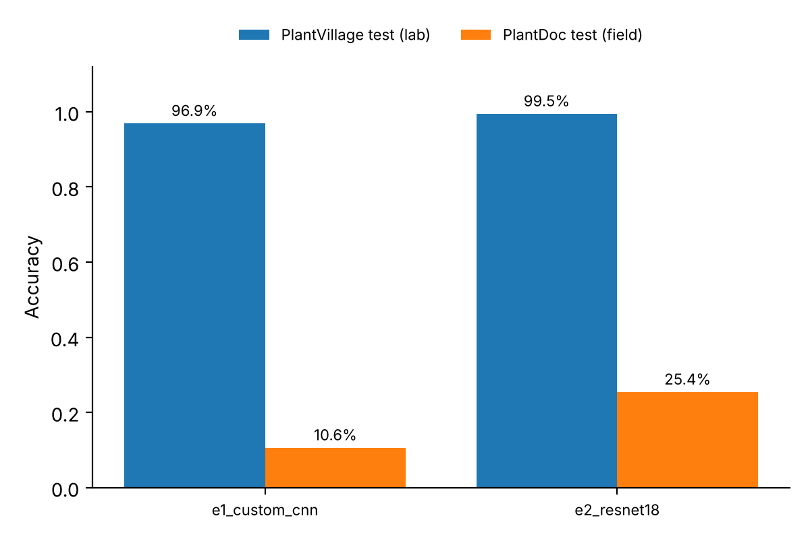

# From Lab to Field: Measuring Domain Shift in Plant-Disease Classification

PlantVillage is close to solved: CNNs reach ~99% on its held-out split. But every
PlantVillage photo is a single leaf on a plain background under controlled light.
PlantDoc contains photos of the same diseases taken in real fields. This project
asks two questions:

1. **How much accuracy does a PlantVillage-trained model lose on field images?**
2. **Which intervention recovers the most of that loss, and at what labelling cost?**

It extends my original [CNN-Plant-Disease-Classifier](https://github.com/KandarpJoshi1112/CNN-Plant-Disease-Classifier)
(38 classes, ~94% validation accuracy) into a controlled experiment.

## Results so far (preliminary: one seed, 10 epochs)

27 shared classes; 5,620 PlantVillage test images, 236 PlantDoc test images.
Chance accuracy is about 3.7%.

| Model | PlantVillage test (lab) | PlantDoc test (field) | Field macro-F1 | Field ECE | Field ECE after temperature scaling |
|---|---|---|---|---|---|
| E1 – CNN from scratch | 96.9% [96.5, 97.3] | **10.6%** [6.8, 14.8] | 0.097 | 0.67 | 0.73 |
| E2 – ResNet-18, ImageNet weights | 99.5% [99.3, 99.6] | **25.4%** [19.9, 30.9] | 0.229 | 0.47 | 0.49 |

Brackets are 95% bootstrap confidence intervals.



**What this shows so far**

- **H1 supported.** Near-perfect lab accuracy says almost nothing about field performance.
  Both models lose more than 70 points, and the from-scratch CNN is barely above chance.
- **H3 supported (preliminary).** ImageNet pre-training more than doubles field accuracy, and
  the confidence intervals do not overlap. The McNemar test and more seeds are still to run.
- **Calibration does not transfer.** Both models are badly over-confident on field images.
  Temperature scaling fitted on lab validation data makes field ECE slightly *worse*, so a
  calibration step tuned in the lab cannot be trusted after deployment.

**Still to do:** seeds 1–2 for E1/E2, E3 (strong augmentation), E4 (few-shot k = 5/10/20),
McNemar tests, and an error analysis of PlantDoc failures.

## Hypotheses

| | Hypothesis | Tested by |
|---|---|---|
| H1 | Accuracy drops sharply from lab to field, and the model stays over-confident on field images (high ECE). | E1, E2 |
| H2 | Random image-level splits overstate PlantVillage accuracy because near-duplicate photos leak between train and test. | Group-aware vs. image-level split |
| H3 | ImageNet pre-training transfers better to field images than a from-scratch CNN. | E1 vs E2 (McNemar) |
| H4 | Strong augmentation narrows the gap but does not close it. | E2 vs E3 |
| H5 | A few labelled field images per class (k = 5–20) recover more than any augmentation. | E4 learning curve |

## Experimental design

- **Label space.** The 27 classes present in both datasets (`configs/class_map.yaml`; tomato spider mites is excluded because PlantDoc's test split lacks it).
  Accuracy is not comparable with the original 38-class result; say so when reporting.
- **Splits.** PlantVillage is split 70/15/15 per class *by duplicate group*
  (`scripts/find_duplicates.py`, perceptual hashing), so near-identical photos never
  straddle train and test. PlantDoc test is never used for training or model selection.
- **Model selection.** Early stopping on PlantVillage validation macro-F1 only. Selecting on
  PlantDoc would leak the target domain.
- **Seeds.** Every experiment runs with three seeds; report mean ± std.
- **Metrics per domain.** Accuracy and macro-F1 with 95% bootstrap CIs, per-class recall,
  confusion matrix, ECE and NLL before and after temperature scaling (temperature fitted on
  PlantVillage validation).
- **Statistical comparison.** Exact McNemar test between two models on the same PlantDoc
  test images (`pdshift.report --compare`).

| ID | Model | Augmentation | Field labels |
|---|---|---|---|
| E1 | Original CNN (from scratch) | basic | 0 |
| E2 | ResNet-18, ImageNet weights | basic | 0 |
| E3 | ResNet-18, ImageNet weights | strong | 0 |
| E4 | ResNet-18, ImageNet weights | strong | k ∈ {5, 10, 20} per class |
| H2 check | E2 with `duplicate_groups` pointed at a missing file | basic | 0 |

**Known limitation.** The PlantDoc test set is small (a few hundred images, some classes with
fewer than 10). Per-class results will be noisy; report the bootstrap CIs and
don't over-interpret single classes. `scripts/check_class_map.py` flags thin classes.

## Setup

```bash
python -m venv .venv && source .venv/bin/activate
pip install -e ".[dev,tracking]"
pytest -q
```

Data (not included):
- **PlantVillage** (colour version) → `data/raw/plantvillage/color/<class folders>`
- **PlantDoc** (classification version, train/test) → `data/raw/plantdoc/{train,test}/<class folders>`

Folder names differ slightly between copies. Fix `configs/class_map.yaml` until this passes:

```bash
python scripts/check_class_map.py
```

## Running

```bash
# 1. Duplicate groups for leakage-free splitting (run once)
python scripts/find_duplicates.py --root data/raw/plantvillage/color \
    --out results/plantvillage_duplicate_groups.csv

# 2. Experiments (3 seeds each)
python -m pdshift.train --override configs/experiments/e1_custom_cnn.yaml
python -m pdshift.train --override configs/experiments/e2_resnet18.yaml
python -m pdshift.train --override configs/experiments/e3_resnet18_strong_aug.yaml
for k in 5 10 20; do
  python -m pdshift.train --override configs/experiments/e4_fewshot.yaml --fewshot-k $k
done

# 3. Summary table, figure and a significance test
python -m pdshift.report --compare e1_custom_cnn/seed0 e2_resnet18/seed0
```

Set `mlflow.enabled: true` in `configs/base.yaml` to track runs in MLflow.

Each run writes to `results/<experiment>/seed<N>[_k<K>]/`:
the exact split files, the best checkpoint, raw logits for both test sets and `metrics.json`.
`results/summary.csv` and `results/lab_vs_field_accuracy.png` aggregate all runs.

E1 uses the `CustomCNN` architecture in `src/pdshift/models.py`.

**Compute:** E1–E3 on a free Colab/Kaggle T4 take roughly 20–40 min per seed at 224 px.

## Project layout

```
configs/            base.yaml, class_map.yaml, experiments/*.yaml
src/pdshift/        config, data (splits, transforms), models, metrics, train, report
scripts/            find_duplicates.py, check_class_map.py
tests/              metric unit tests
results/            metrics.json per run, summary.csv, figure (checkpoints and logits are git-ignored)
```

## Possible extensions

- **Error analysis.** Group PlantDoc errors by cause: background clutter, multiple leaves,
  blur, wrong species. A 50-image manual audit is enough to say something concrete.
- **Background-shortcut test.** Evaluate on PlantVillage images with backgrounds replaced. If
  accuracy falls, the model is partly using the background.
- **Unsupervised adaptation.** Test-time BatchNorm statistics adaptation on PlantDoc (no labels)
  as a zero-label baseline against E4.
